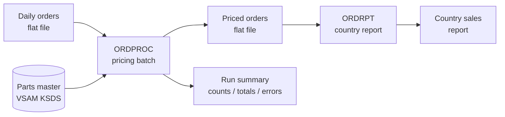
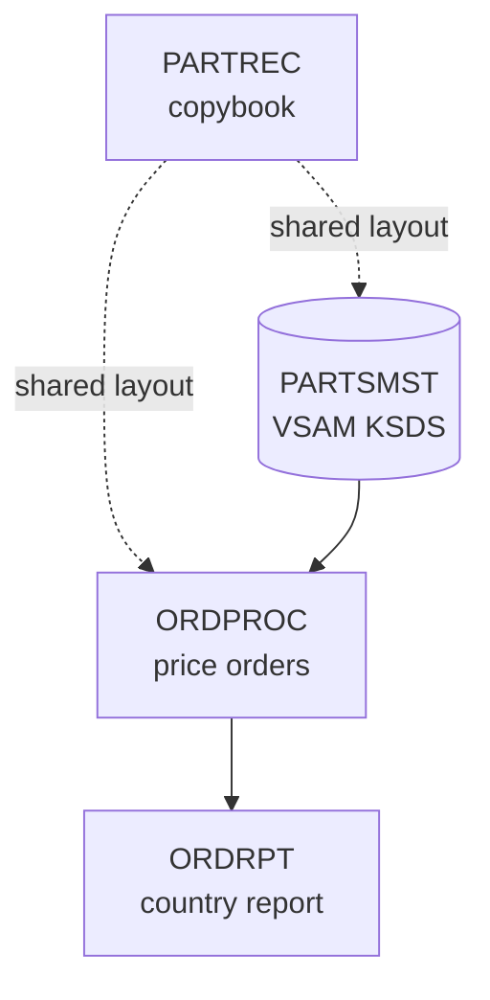
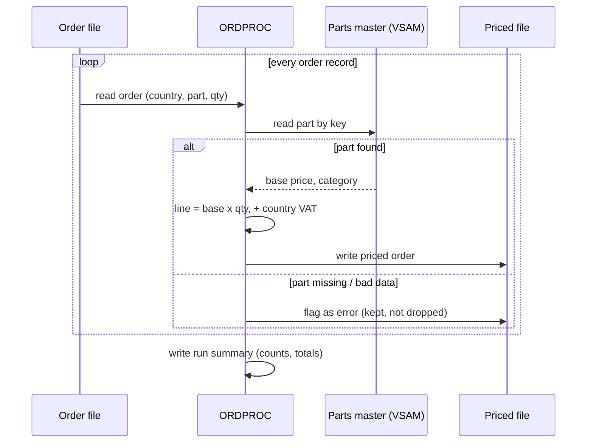

# Architecture

## Data flow

## Components

## Pricing sequence (UC-2)

## Design notes

- **Money as packed decimal** (`COMP-3`) — exact, no floating point.
- **Country VAT** resolved by a small decision table (country → rate); an unknown
  country is an explicit error path, never silently zero.
- **Errors are kept and flagged**, never dropped — a priced run is fully
  reconcilable against its input record count.
