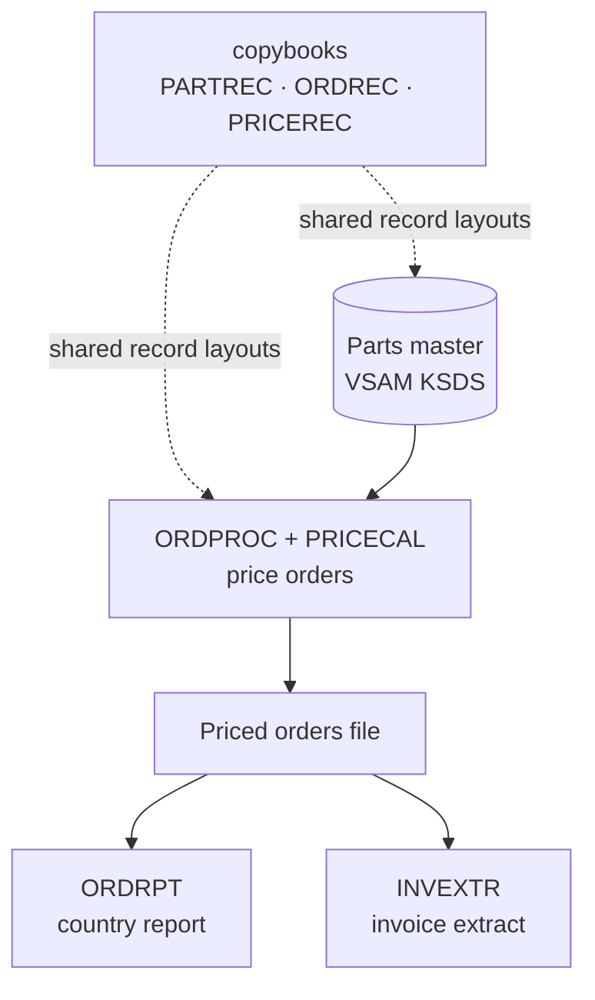
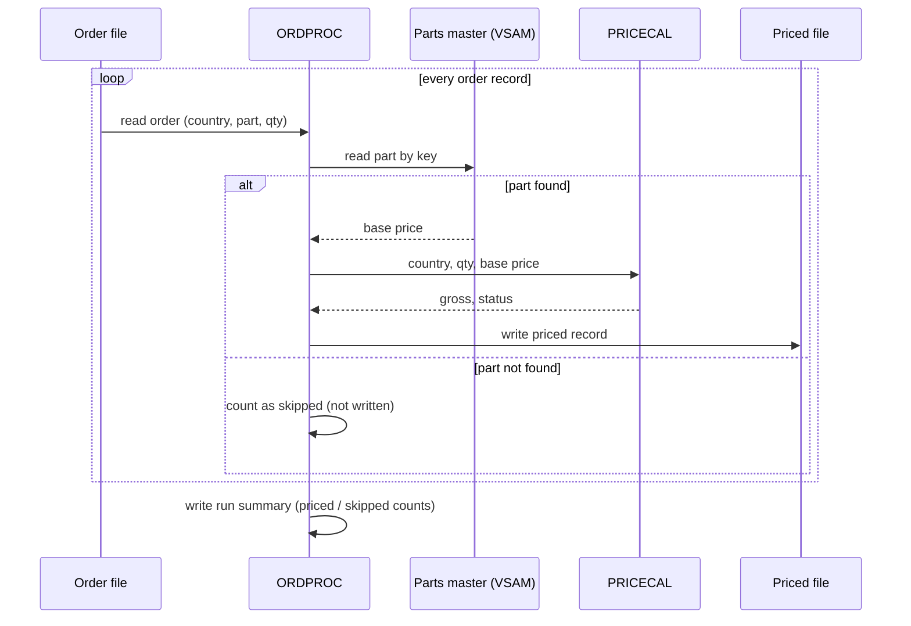

# Architecture

The daily flow is in [pipeline.md](pipeline.md); this note covers the internals
and the design decisions.

## Components

## Pricing sequence (UC-2)

## Storage — VSAM

The parts, orders and priced results are **VSAM / sequential files** — keyed,
navigational access native to z/OS. A single part is fetched directly by its key
(`look up part by part number`), not joined across tables. Fast and predictable
for the known access path.

## Design decisions

- **Logic separated from I/O** — the pricing rules live in `PRICECAL` (no file
  access, inputs/outputs via `LINKAGE`), so they are unit-tested on their own;
  `ORDPROC` just calls them. One tested source of truth for the rules.
- **Money as packed decimal** (`COMP-3`) — exact, no floating point.
- **Country VAT** from a small decision table (country → rate); an unknown
  country is an explicit `status 'E'`, never a silent zero.
- **Unknown parts are skipped, not hidden** — counted and reported, so a run is
  reconcilable against its input count.
- **Two-layer testing** — pricing logic is unit-tested (`make test`); the full
  catalogue → pricing → report → extract flow runs locally (`make run`).
