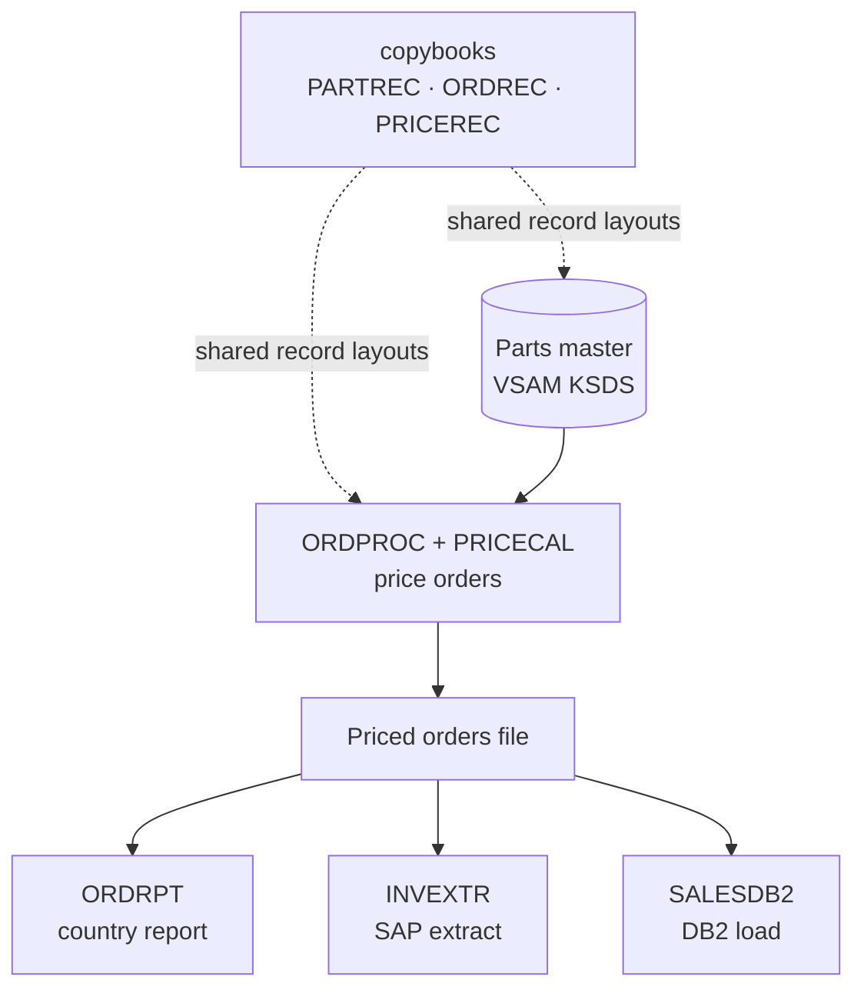

# Architecture

The daily flow is in [pipeline.md](pipeline.md); this note covers the internals
and the design decisions.

## Components

## Pricing sequence (UC-2)

## Two data models

The same flow uses both storage styles found on a real estate:

| | VSAM (parts, orders, priced) | DB2 (sales summary) |
|---|---|---|
| Kind | keyed / sequential files | relational tables |
| Access | **navigational** — read by key | **relational** — SQL, set-based |
| Who plans the access path | you (the program) | the DB2 optimizer |
| Strength | fast, predictable for known paths | flexible, any query |

Operational, high-volume data stays in VSAM (navigational, cheap for the known
"look up a part by key" path). The analytics copy goes to DB2 so reporting can
query it with ordinary SQL. Understanding which store holds what — and how data
moves between them — is the core of the "data flow" analysis work.

## Design decisions

- **Logic separated from I/O** — the pricing rules live in `PRICECAL` (no file
  access, inputs/outputs via `LINKAGE`), so they are unit-tested on their own;
  `ORDPROC` just calls them. One tested source of truth for the rules.
- **Money as packed decimal** (`COMP-3`) — exact, no floating point.
- **Country VAT** from a small decision table (country → rate); an unknown
  country is an explicit `status 'E'`, never a silent zero.
- **Errors are flagged, not hidden** — an unknown part is counted and reported,
  so a run is reconcilable against its input count.
- **Two-layer testing** — pricing logic is unit-tested locally (GnuCOBOL,
  `make test`); the full VSAM / JCL / DB2 path is integration-tested on z/OS.
