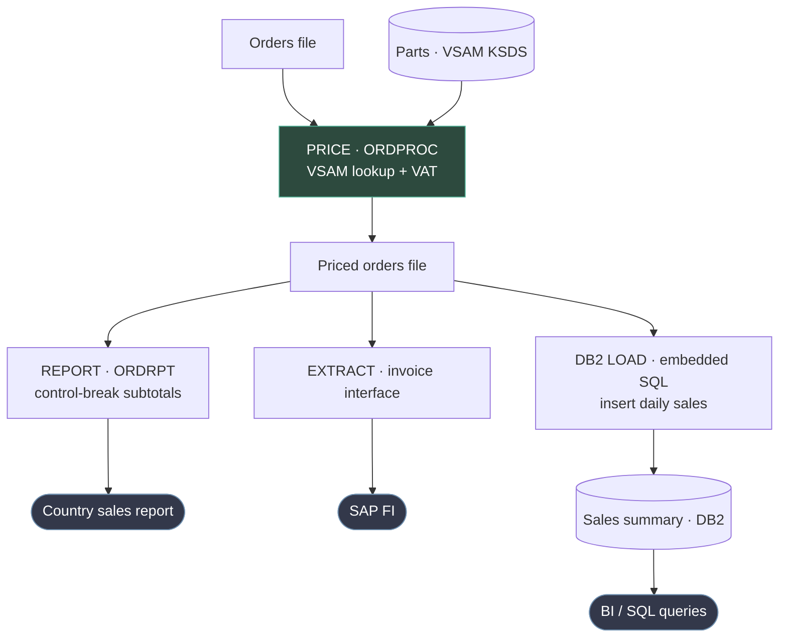

# Daily spare-parts order processing — pipeline

A compact mainframe batch flow: price the day's orders against the parts
catalogue, then fan the result out to three downstream actions — a report, an
invoicing interface, and an analytics table.

Built in this lab: **PRICE** (`ORDPROC`). The surrounding steps are the
enterprise flow around it, realised as job steps in
[order-pricing/DAILYRUN.jcl](../order-pricing/DAILYRUN.jcl).

## Steps

| # | Step | Does | Output |
|---|------|------|--------|
| 1 | **PRICE** (`ORDPROC`) | look up each part in the VSAM catalogue; compute qty × price + country VAT | priced orders file |
| 2 | **REPORT** (`ORDRPT`) | control-break report: subtotals per country, grand total | country sales report |
| 3 | **EXTRACT** | build the invoicing interface file | → SAP FI |
| 4 | **DB2 LOAD** | insert the day's sales into a DB2 table (embedded SQL) | → BI / SQL queries |

## Two data models in one flow

Operational data lives in **VSAM** (parts, orders, priced results) — keyed files,
navigational access, fast for known paths. The analytics summary lands in **DB2**
(relational), queryable with SQL by downstream reporting. The same flow shows
both storage models side by side — see
[COOKBOOK.md](COOKBOOK.md) → *Datový model na sále*.

## Data flow, branching & integration

- **Data flow** — each step passes its output dataset to the next; `PRICE` fans
  one priced file out to three independent consumers.
- **Branching** — the priced file is read by three parallel steps (report,
  invoice extract, DB2 load): a fan-out.
- **Integration** — the SAP interface file and the DB2 table are the seams to
  other systems.
- **Change impact** — a change in `PRICE` ripples through the priced file into
  all three downstream outputs; tracing that ripple is the core analysis task.
