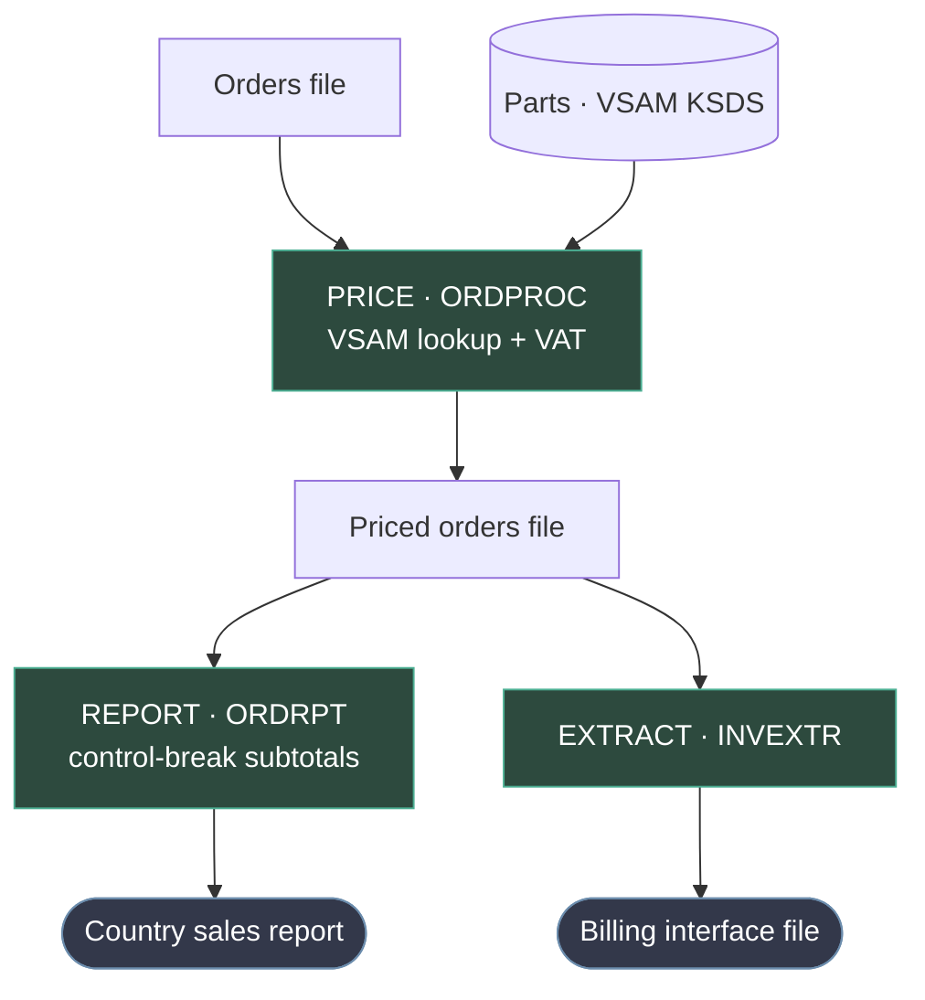

# Daily spare-parts order processing — pipeline

Price the day's orders against the parts catalogue, then fan the result out to a
report and an invoicing interface.

## Steps

| # | Step | Does | Output |
|---|------|------|--------|
| 1 | **PRICE** (`ORDPROC`) | look up each part in the VSAM catalogue; compute qty × price + country VAT | priced orders file |
| 2 | **REPORT** (`ORDRPT`) | control-break report: subtotals per country, grand total | country sales report |
| 3 | **EXTRACT** (`INVEXTR`) | map priced orders into the invoicing layout | billing interface file |

## Data flow, branching & integration

- **Data flow** — each step passes its output dataset to the next; `PRICE` fans
  one priced file out to two consumers.
- **Branching** — the priced file is read by two parallel steps (report, extract).
- **Integration** — the billing interface file is the seam to the downstream
  billing system.
- **Change impact** — a change in `PRICE` ripples through the priced file into
  both downstream outputs; tracing that ripple is the core analysis task.
